  
  

  

## 👋 About me

Junior software developer at **Pargesoft**, based in Istanbul. I build and maintain websites and handle social media content. I'm also studying for a bachelor's degree in Information Systems and Technologies.

- 🌐 **Web**: bilingual (English/Turkish) static sites with [Astro](https://astro.build) on Cloudflare
- 📣 **Social media**: turning blog posts, webinars and product updates into LinkedIn content
- 📚 **Learning**: databases and ERP systems

## 🚀 Featured projects

<table>
  <tr>
    <td width="50%" valign="top">
      <h3><a href="https://www.phioil.com">PhiOil</a></h3>
      
Bilingual corporate website for a lubricants and international trade company.

      

        
        
        
      

      <a href="https://www.phioil.com"><b>phioil.com →</b></a>
    </td>
    <td width="50%" valign="top">
      <h3><a href="https://github.com/T4pio/Solu_library">SOLU Library</a></h3>
      
Community book-sharing platform: lend and borrow books, with a trust score and badges.

      

        
        
        
      

      <a href="https://github.com/T4pio/Solu_library"><b>View repo →</b></a>
    </td>
  </tr>
</table>

### More projects

| Project | What it is | Stack |
| --- | --- | --- |
| [Hospital-Management-System-](https://github.com/T4pio/Hospital-Management-System-) | Hospital management system | C# · Windows Forms |
| [Employee-Management-System](https://github.com/T4pio/Employee-Management-System) | Employee management system | C# |
| [C-forms-for-new-C-coders](https://github.com/T4pio/C-forms-for-new-C-coders) | Ten small apps for beginners: calculator, to-do list, text editor, image viewer and more | C# · Windows Forms |
| [FlappyBird](https://github.com/T4pio/FlappyBird) | Flappy Bird clone | C# · Windows Forms |

## 🛠️ Tech I use

   
  

Also: Microsoft SQL Server

## 📊 GitHub stats

  

  
  

  
  

  

  

